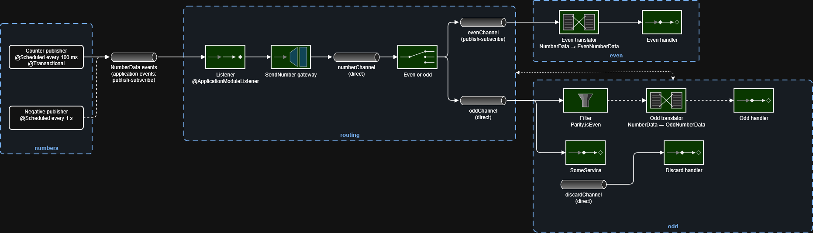

# Lab 5 Modules & Application Events -- Project Report

## EIP diagram (before)



The starter firstly does not process any negative numbers as they don't have the `@Transactional`, meaning the numbers won't get sent 
trough the `NumberData` channel.

Then we have the `evenChannel` and `oddChannel` channels types which are flipped from what the original say.

When entering the odd module, the first thing the events pass is a filter which rejects any odd number. When it gets rejected, there is another channel where it should send the discarded messages but they don't send them through that channel, throwing a warning each time an
odd numbers goes through the channel and there is now another channel (`discardChannel`)which isn't being used.

We also have the `routing` module importing a method from the `odd` module and vice versa.

## What I specified

Firstly, the negative numbers should be treated the same as positive numbers, following the same event flow.

Secondly, the `evenChannel` must be a direct channel, while the `oddChannel`must be publish-subscribe

Then, in the odd module, there shouldn't be a filter when receiving new events through the channel, the events should go directly to the translator and should resolve the odd events always being discarded.

We also remove everything related to the `discardChannel` as it isn't being used anyways.

And finally, we should remove any imports from other modules which shouldn't have access to.

## What I changed

The following files were changed that mainly relate to the event flow
```
/src/main/kotlin/soa/numbers/NumberSources.kt
/src/main/kotlin/soa/routing/RoutingFlows.kt
/src/main/kotlin/soa/odd/OddFlows.kt
```

In `NumberSources.kt`, I've simply added the @Transactional attribute to the negativesNumbers
In `RoutingFlows.kt`, I've changed which channel is the one that does the publish-subscribe, remove any imports from other modules and
changing the logic behind channel selection
In `OddFlows.kt`, I've removed the filter and everything related to the `discardChannel`.

## Technical decisions

Adding the @Transactional tag for negative numbers so they can actually be sent to the `NumberChannel`

Changing the channel which is publish-subscribe from even to odd, as it's shown in the EIP diagram.

Removed the filter which was not required in `oddFlow`

Removed the flow regarding discarded events as it's not required and wasn't being used

Removing the `soa.odd.OddNumberData` import in `RoutingFlows.kt` and changing `channel` so it uses `isEven` function.

Removing the `import soa.routing.internal.Parity` import in `OddFlows.kt` as it is not used.

## How I verified

Firstly I've ran the program every time I've done any modification to see if the output slowly resembles to the one expected.
After ensuring the output matches to the expected result, I've ran `./gradlew check` to ensure the tests passes and everything
I've changed and written is correct.

## AI disclosure

- **Tools / skills:** Claude Opus 5.5
- **Purpose:** Helping out in seeing the main differences from the diagram
- **Representative prompts:** I've seen this mismatch between the diagram and the code, is there any more that I'm missing?
- **Affected files/sections:** None
- **Validation steps:** Checking if the different it pointed out is actually true
- **Human-reviewed:** Changing the difference detected to ensure if it actually affects the output.

